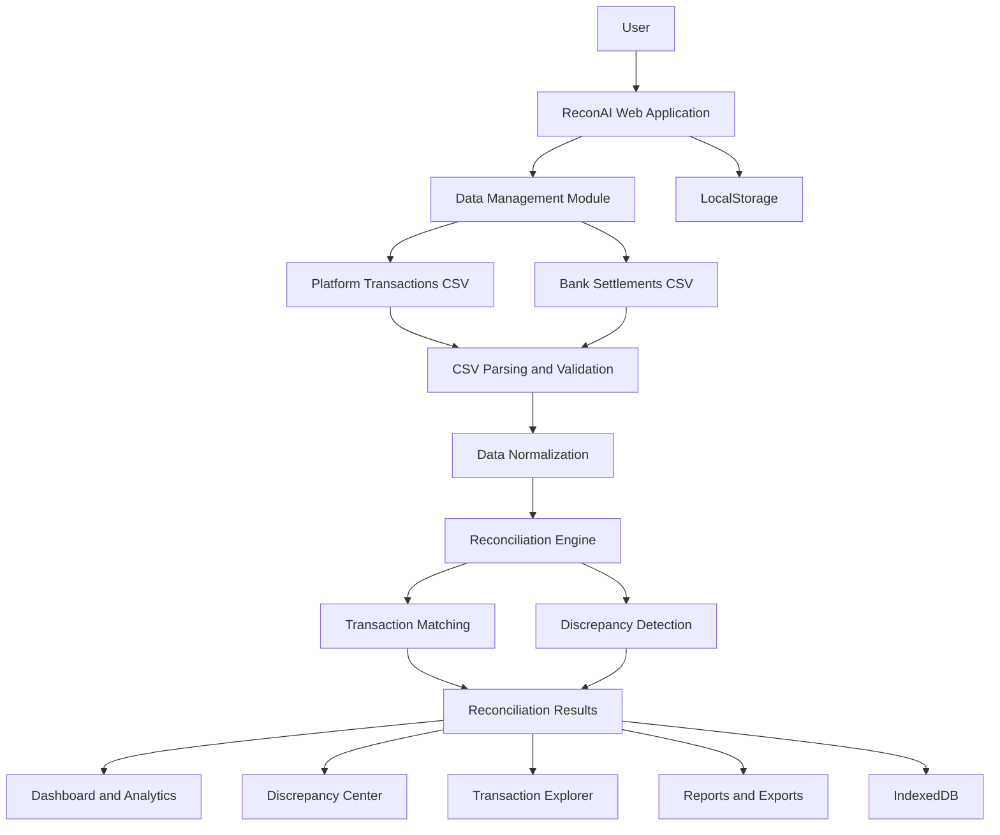
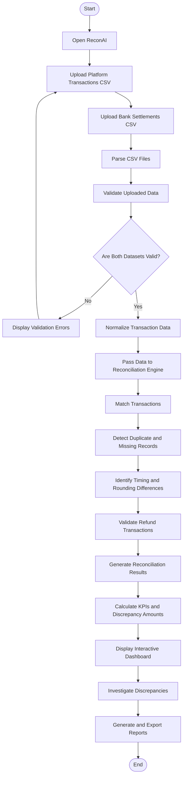
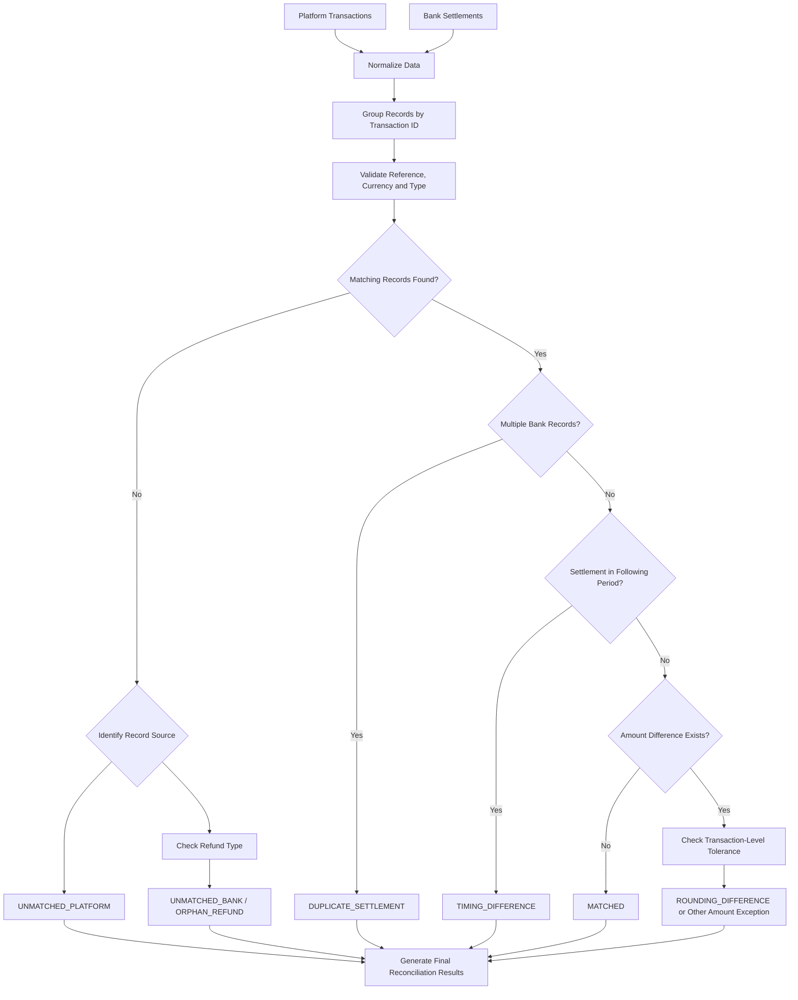

# ReconAI – Intelligent Payment Reconciliation Platform

<p align="center">
  <h2 align="center">ReconAI</h2>
  <p align="center">
    <b>Intelligent Payment Reconciliation & Discrepancy Detection System</b>
  </p>
  <p align="center">
    An automated platform for comparing payment transactions with bank settlement records, identifying financial discrepancies, and simplifying month-end reconciliation.
  </p>
</p>

---

## 1. Project Overview

**ReconAI** is a web-based payment reconciliation application designed to automate the process of comparing internal payment platform transactions against external bank settlement records.

In financial systems, payment platforms and banking systems maintain separate records of transactions. Although both systems represent the same financial activities, their records may not always match due to settlement delays, duplicate entries, rounding differences, missing transactions, or refund mismatches.

ReconAI addresses this problem by allowing users to upload transaction datasets in CSV format, process the records through a reconciliation engine, identify discrepancies, and view the results through an interactive analytics dashboard.

The application follows a **rule-based reconciliation approach**, ensuring that financial matching and discrepancy calculations are deterministic, explainable, and consistent.

The system is designed as a lightweight frontend application with browser-based data persistence, making it suitable for demonstrating automated payment reconciliation without requiring an external database server.

## 2. Problem Statement

Businesses process thousands of transactions through payment gateways, financial platforms, and banking systems. At the end of every financial period, these records must be compared to ensure that all transactions have been correctly settled.

Manual reconciliation becomes difficult when datasets contain large numbers of records and multiple types of discrepancies.

Some common reconciliation challenges are:

1. **Timing Differences:** A transaction recorded in one month may be settled by the bank in the following month.
2. **Rounding Differences:** Small differences in individual transaction amounts may create a noticeable aggregate difference.
3. **Duplicate Settlements:** The same transaction may appear more than once in the bank settlement statement.
4. **Unmatched Transactions:** A transaction may exist in the platform dataset but not in the bank dataset, or vice versa.
5. **Orphan Refunds:** A refund may appear in the bank records without a corresponding original payment in the platform records.

These problems can result in inaccurate financial reports, delayed month-end closing, and additional manual investigation.

### Proposed Solution

ReconAI provides an automated reconciliation system that:

- Accepts platform transaction and bank settlement CSV files.
- Validates and normalizes the uploaded records.
- Matches transactions using identifiers and reference information.
- Detects duplicate, timing, rounding, and unmatched records.
- Identifies refunds without corresponding original transactions.
- Calculates reconciliation success rates and discrepancy amounts.
- Displays results through interactive dashboards and transaction tables.
- Provides tools to investigate and export reconciliation results.

## 3. Project Objectives

The main objectives of ReconAI are:

- Automate the comparison of payment platform and bank settlement records.
- Reduce manual reconciliation efforts.
- Identify and categorize different types of financial discrepancies.
- Improve the accuracy and transparency of financial reconciliation.
- Support month-end settlement analysis.
- Provide transaction-level visibility into unmatched and duplicate records.
- Generate meaningful reconciliation summaries and reports.
- Demonstrate a modular and scalable approach to financial data processing.

## 4. Key Features

### 4.1 Interactive Dashboard

The dashboard provides an overview of the complete reconciliation process.

**Key Performance Indicators (KPIs):**

- Total Platform Transactions
- Total Bank Settlement Records
- Successfully Matched Transactions
- Reconciliation Success Rate
- Total Discrepancy Amount
- Pending Settlements
- Duplicate Settlements
- Unmatched Transactions

**Dashboard Analytics:**

- Reconciliation status distribution.
- Discrepancy category breakdown.
- Platform versus bank amount comparison.
- Transaction reconciliation statistics.
- Settlement and discrepancy summaries.

### 4.2 CSV Data Management

Users can upload two datasets:

1. Platform Transactions CSV.
2. Bank Settlements CSV.

The application processes and validates uploaded records.

Validation includes:

- Required column availability.
- Missing transaction identifiers.
- Invalid dates.
- Invalid monetary values.
- Currency mismatches.
- Duplicate records.
- Incorrect data formats.

### 4.3 Synthetic Data Generator

The application provides a synthetic dataset generation feature to test the reconciliation engine.

It generates sample platform and bank settlement records with controlled scenarios, including:

- Exact transaction matches.
- Next-month settlements.
- Rounding differences.
- Duplicate settlement entries.
- Unmatched platform transactions.
- Unmatched bank transactions.
- Orphan refunds.

This allows the reconciliation logic to be tested without requiring real financial data.

### 4.4 Automated Reconciliation Engine

The reconciliation engine is the core of the application.

It compares platform transactions with bank settlement records and assigns appropriate reconciliation statuses.

The engine performs:

- Transaction identification.
- Reference validation.
- Amount comparison.
- Settlement date analysis.
- Duplicate detection.
- Refund validation.
- Exception classification.

### 4.5 Discrepancy Center

The Discrepancy Center provides a centralized interface for investigating reconciliation exceptions.

Users can:

- View discrepancies by category.
- Search using transaction identifiers.
- Compare platform and bank amounts.
- Inspect transaction and settlement dates.
- Identify duplicate settlement records.
- Investigate missing transactions.
- Review refund mismatches.

### 4.6 Transaction Explorer

The Transaction Explorer provides detailed information about individual transaction records.

It allows users to:

- Search transactions.
- Filter records by reconciliation status.
- Sort transaction information.
- Inspect platform and bank records.
- Review transaction amounts and references.

### 4.7 Reports and Exports

The reporting module provides summarized reconciliation information.

Depending on the implemented export functionality, users can export:

- Reconciliation summaries.
- Matched transactions.
- Unmatched transactions.
- Discrepancy reports.
- Transaction-level details.

Supported formats may include CSV, Excel, and PDF.

### 4.8 Audit Trail

The Audit Trail maintains a local history of important application activities, such as:

- CSV uploads.
- Reconciliation executions.
- Synthetic dataset generation.
- Data modifications.
- Report exports.

### 4.9 Local Data Persistence

The application uses browser-based storage to preserve data between sessions.

| Storage Technology | Purpose |
|---|---|
| IndexedDB | Stores transaction datasets and reconciliation data |
| LocalStorage | Stores lightweight application preferences and settings |

No external database server is required for the current prototype.

---

## 5. Technology Stack

| Technology | Purpose |
|---|---|
| React.js | Component-based frontend development |
| Vite | Development server and build tooling |
| JavaScript ES6+ | Application and reconciliation logic |
| CSS3 | Styling and responsive layouts |
| React Router | Navigation between application modules |
| Lucide React | Icons and interface elements |
| Recharts | Dashboard charts and analytics |
| PapaParse | CSV parsing and processing |
| IndexedDB | Local transaction data persistence |
| LocalStorage | Application preferences |
| jsPDF | PDF report generation, if implemented |
| Vitest | Unit testing, if configured |

---

## 6. System Architecture

ReconAI follows a modular frontend architecture in which data processing, reconciliation, analytics, and storage are separated into logical components.

The application starts with CSV uploads from the user. The uploaded files are parsed, validated, and normalized before being passed to the reconciliation engine.

The reconciliation engine compares both datasets, detects exceptions, and generates structured reconciliation results.

These results are then used by the dashboard, discrepancy center, transaction explorer, and reporting modules.

### 6.1 High-Level System Architecture



### 6.2 Architecture Components

| Component | Responsibility |
|---|---|
| User Interface | Provides application screens and user interactions |
| Data Management Module | Handles CSV uploads and dataset selection |
| CSV Parser | Reads CSV records and converts them into structured data |
| Validation Layer | Checks required fields and data formats |
| Normalization Layer | Standardizes dates, amounts, identifiers, and currencies |
| Reconciliation Engine | Compares platform and bank transaction records |
| Matching Module | Identifies corresponding transactions |
| Discrepancy Detector | Identifies and classifies reconciliation exceptions |
| Analytics Module | Calculates KPIs and chart data |
| Storage Layer | Persists application data locally |
| Reporting Module | Generates downloadable reconciliation reports |

---

## 7. Working Methodology

ReconAI follows a structured reconciliation workflow consisting of several stages.

### Step 1: Data Collection

The user provides two CSV files:

- Platform Transactions CSV.
- Bank Settlements CSV.

The platform file contains records of transactions processed by the payment platform, while the bank file contains the corresponding settlement entries.

### Step 2: CSV Parsing

The application reads the uploaded files using a CSV parsing utility.

Each row is converted into a structured JavaScript object.

The parsed data is then made available for validation and further processing.

### Step 3: Data Validation

Before reconciliation, the application validates the uploaded datasets.

The validation process checks:

- Whether all mandatory columns are present.
- Whether transaction identifiers are available.
- Whether monetary values are valid.
- Whether date values follow the expected format.
- Whether currency information is consistent.
- Whether records contain missing or invalid values.

Invalid records should be reported instead of silently treated as successfully reconciled transactions.

### Step 4: Data Normalization

The two datasets may contain differences in formatting.

Therefore, the application standardizes important fields before matching.

Normalization includes:

- Trimming unnecessary spaces.
- Standardizing transaction identifiers.
- Normalizing date formats.
- Converting monetary values into integer minor units (paise).
- Standardizing transaction and settlement types.
- Normalizing currency codes.

This ensures that formatting differences do not create unnecessary reconciliation failures.

### Step 5: Transaction Matching

The reconciliation engine identifies corresponding records using transaction IDs as the primary matching key.

Reference IDs, transaction types, currencies, and monetary amounts are also checked to validate the relationship between records.

### Step 6: Discrepancy Detection

After matching, the engine identifies records that do not satisfy the reconciliation rules.

These records are categorized into:

- Timing differences.
- Rounding differences.
- Duplicate settlements.
- Unmatched platform transactions.
- Unmatched bank transactions.
- Orphan refunds.

### Step 7: Reconciliation Result Generation

The engine generates structured results containing:

- Transaction ID.
- Platform transaction amount.
- Bank settlement amount.
- Transaction date.
- Settlement date.
- Reconciliation status.
- Difference amount.
- Discrepancy category.

### Step 8: KPI Calculation

The application calculates reconciliation statistics, including:

- Total transactions.
- Successfully matched transactions.
- Reconciliation success rate.
- Total discrepancy amount.
- Number of exceptions by category.

### Step 9: Dashboard Visualization

The reconciliation results are displayed through dashboard cards, charts, tables, and discrepancy summaries.

### Step 10: Investigation and Reporting

Users can inspect individual exceptions, understand the reason for the mismatch, and export the reconciliation information.

### 7.1 Complete Application Workflow Diagram



---

## 8. Reconciliation Engine and Matching Logic

The reconciliation engine is the primary business logic component of ReconAI.

Its responsibility is to compare the platform and bank datasets and determine whether each transaction has been correctly settled.

### 8.1 Primary Matching Criteria

The engine uses the following fields:

| Field | Purpose |
|---|---|
| Transaction ID | Primary transaction matching key |
| Reference ID | Additional reference validation |
| Transaction Type | Identifies payments and refunds |
| Currency | Ensures both records use the same currency |
| Platform Amount | Amount recorded by the payment platform |
| Settlement Amount | Amount recorded by the bank |
| Transaction Date | Date of the original transaction |
| Settlement Date | Date of the bank settlement |

### 8.2 Reconciliation Statuses

The application classifies transactions into the following statuses:

| Status | Description |
|---|---|
| MATCHED | Platform and bank records match successfully |
| TIMING_DIFFERENCE | Transaction is settled in a different reporting period |
| ROUNDING_DIFFERENCE | Platform and bank amounts differ within the rounding analysis rules |
| DUPLICATE_SETTLEMENT | Multiple bank settlement entries refer to the same transaction |
| UNMATCHED_PLATFORM | Platform transaction has no corresponding bank settlement |
| UNMATCHED_BANK | Bank settlement has no corresponding platform transaction |
| ORPHAN_REFUND | Refund exists without a corresponding original payment |

### 8.3 Exact Match

A transaction is considered successfully reconciled when:

- A corresponding bank record exists.
- Transaction identifiers and references are consistent.
- Transaction type and currency are valid.
- Platform and bank amounts match.
- No duplicate settlement exists.

### 8.4 Timing Difference

A timing difference occurs when a platform transaction is recorded in one reporting period but its bank settlement occurs in a later period.

**Example:**

| Field | Value |
|---|---|
| Transaction ID | TXN005 |
| Platform Date | 30 October 2026 |
| Bank Settlement Date | 1 November 2026 |
| Amount | ₹500.00 |
| Status | TIMING_DIFFERENCE |

For October reconciliation, the November settlement must still be available to the matching process.

Otherwise, the application may incorrectly classify TXN005 as an unmatched platform transaction.

### 8.5 Rounding Difference

Rounding differences occur when the amount recorded by the platform differs slightly from the amount recorded by the bank.

**Example:**

| Transaction ID | Platform Amount | Bank Amount | Difference |
|---|---:|---:|---:|
| TXN003 | ₹333.33 | ₹333.32 | ₹0.01 |
| TXN004 | ₹666.67 | ₹666.66 | ₹0.01 |
| **Total** | **₹1,000.00** | **₹999.98** | **₹0.02** |

Each transaction has a difference of ₹0.01.

However, when both transactions are aggregated, the total difference becomes ₹0.02.

This demonstrates why aggregate-level rounding analysis is important in financial reconciliation.

### 8.6 Duplicate Settlement

A duplicate settlement occurs when multiple bank entries refer to the same platform transaction.

**Example:**

| Settlement ID | Transaction ID | Amount |
|---|---|---:|
| SET006A | TXN006 | ₹1,200.00 |
| SET006B | TXN006 | ₹1,200.00 |

The platform contains one transaction of ₹1,200, while the bank contains two settlement entries of ₹1,200 each.

The duplicate excess amount is ₹1,200.

The engine must identify the duplicate without treating both settlement records as separate successful matches.

### 8.7 Unmatched Platform Transaction

A platform transaction is unmatched when no corresponding bank settlement record exists.

**Example:**

| Transaction ID | Platform Amount | Status |
|---|---:|---|
| TXN008 | ₹900.00 | UNMATCHED_PLATFORM |

### 8.8 Unmatched Bank Transaction

A bank transaction is unmatched when no corresponding platform record exists.

**Example:**

| Transaction ID | Bank Amount | Status |
|---|---:|---|
| TXN011 | ₹300.00 | UNMATCHED_BANK |

### 8.9 Orphan Refund

An orphan refund occurs when a bank refund record exists without a corresponding original payment in the platform dataset.

**Example:**

| Field | Value |
|---|---|
| Transaction ID | TXN9999 |
| Settlement Type | REFUND |
| Refund Amount | -₹150.00 |
| Status | ORPHAN_REFUND |

Refunds must be processed separately from normal payment credits.

---

## 9. Reconciliation Algorithm

The following flowchart represents the high-level decision-making process of the reconciliation engine.



**Note:** This is a conceptual decision flow. Actual implementation should also handle multiple settlements, partial payments, conflicting references, and invalid records according to the application's matching rules.

### 9.1 Important Financial Calculation Rules

To maintain financial accuracy:

1. Convert monetary values into integer minor units (paise) before comparison.
2. Avoid floating-point arithmetic for financial calculations.
3. Apply transaction-level tolerance separately from aggregate tolerance.
4. Identify duplicate settlements before counting a transaction as cleanly matched.
5. Keep next-month settlement records available during month-end reconciliation.
6. Process refunds separately from normal payment settlements.
7. Calculate duplicate impact using only the excess amount.
8. Avoid counting the same discrepancy more than once.
9. Distinguish accounting discrepancies from actual financial losses.

---

## 10. Financial Metrics and KPI Calculations

ReconAI calculates financial and reconciliation metrics from the processed datasets.

### 10.1 Reconciliation Success Rate

The reconciliation success rate represents the percentage of unique platform transactions that have been successfully matched with corresponding bank settlement records without any identified discrepancy.

**Formula:**

```text
Reconciliation Success Rate =
(Cleanly Matched Platform Transactions /
 Total Unique Platform Transactions) × 100
```

For the supplied sample dataset:

```text
Cleanly Matched Transactions = 5

Total Unique Platform Transactions = 10

Success Rate = (5 / 10) × 100

Success Rate = 50%
```

Only cleanly matched transactions should be included in the numerator.

Transactions with timing differences, rounding differences, duplicate settlements, unmatched records, and orphan refunds must not be counted as clean matches.

### 10.2 Total Discrepancy Amount

The total discrepancy amount represents the sum of the absolute financial impacts of the identified exception categories under the defined calculation method.

For the supplied dataset:

| Discrepancy Type | Financial Impact |
|---|---:|
| Timing Difference | ₹500.00 |
| Aggregate Rounding Difference | ₹0.02 |
| Duplicate Settlement Excess | ₹1,200.00 |
| Unmatched Platform Transaction | ₹900.00 |
| Unmatched Bank Transaction | ₹300.00 |
| Orphan Refund | ₹150.00 |
| **Total** | **₹3,050.02** |

The timing difference is included in the discrepancy KPI for monitoring purposes, but it should not automatically be interpreted as a permanent financial loss.

### 10.3 Financial Calculation Considerations

The discrepancy amount is an operational KPI based on the defined exception impacts.

For actual accounting reconciliation, the application should separately track:

- Gross payment credits.
- Settlement debits and credits.
- Refunds.
- Duplicate settlement excess.
- Platform-only transactions.
- Bank-only transactions.
- Timing differences.
- Processing fees and adjustments.

These amounts should not be blindly added or subtracted without considering their accounting meaning.

---

## 11. Sample Dataset and Expected Results

The project includes two sample CSV files for testing the reconciliation engine.

### 11.1 Platform Transactions Dataset

**File:** `platform_transactions.csv`

Contains 10 platform transaction records.

**Columns:**

```text
transaction_id
order_id
customer_id
transaction_date
amount
currency
transaction_type
transaction_status
payment_method
reference_id
```

### 11.2 Bank Settlements Dataset

**File:** `bank_settlements.csv`

Contains 12 bank settlement records.

**Columns:**

```text
settlement_id
transaction_id
settlement_date
settlement_amount
currency
settlement_type
reference_id
bank_reference
```

### 11.3 Expected Transaction-Level Results

| Transaction | Expected Classification |
|---|---|
| TXN001 | MATCHED |
| TXN002 | MATCHED |
| TXN003 | ROUNDING_DIFFERENCE |
| TXN004 | ROUNDING_DIFFERENCE |
| TXN005 | TIMING_DIFFERENCE |
| TXN006 | DUPLICATE_SETTLEMENT |
| TXN007 | MATCHED |
| TXN008 | UNMATCHED_PLATFORM |
| TXN009 | MATCHED |
| TXN010 | MATCHED |
| TXN011 | UNMATCHED_BANK |
| TXN9999 | ORPHAN_REFUND |

### 11.4 Expected Reconciliation Summary

| Metric | Expected Result |
|---|---:|
| Platform Transactions | 10 |
| Bank Settlement Records | 12 |
| Cleanly Matched Transactions | 5 |
| Reconciliation Success Rate | 50% |
| Total Discrepancy Amount | ₹3,050.02 |
| Timing Differences | 1 |
| Rounding-Affected Transactions | 2 |
| Duplicate Settlement Groups | 1 |
| Unmatched Platform Transactions | 1 |
| Unmatched Bank Transactions | 1 |
| Orphan Refunds | 1 |

**Important:** The expected results use October 2026 as the reporting period while retaining the November settlement record for TXN005. The duplicate group is counted once, with an excess impact of ₹1,200. The aggregate rounding difference is counted once as ₹0.02.

---

## 12. Project Folder Structure

The application follows a modular structure to separate UI components, business logic, utilities, and local storage.

The following is a suggested structure. Adjust it according to the actual implementation.

```text
ReconAI/
│
├── public/
│
├── src/
│   │
│   ├── assets/
│   │
│   ├── components/
│   │   ├── Sidebar.jsx
│   │   ├── Header.jsx
│   │   ├── StatCard.jsx
│   │   ├── DataTable.jsx
│   │   └── ChartCard.jsx
│   │
│   ├── pages/
│   │   ├── Dashboard.jsx
│   │   ├── DataManagement.jsx
│   │   ├── DataGenerator.jsx
│   │   ├── Reconciliation.jsx
│   │   ├── DiscrepancyCenter.jsx
│   │   ├── TransactionExplorer.jsx
│   │   ├── Reports.jsx
│   │   ├── AuditTrail.jsx
│   │   └── Settings.jsx
│   │
│   ├── services/
│   │   ├── reconciliationEngine.js
│   │   ├── csvService.js
│   │   ├── validationService.js
│   │   └── exportService.js
│   │
│   ├── utils/
│   │   ├── currency.js
│   │   ├── dateUtils.js
│   │   └── calculations.js
│   │
│   ├── storage/
│   │   └── indexedDB.js
│   │
│   ├── styles/
│   │
│   ├── App.jsx
│   └── main.jsx
│
├── tests/
│   └── reconciliationEngine.test.js
│
├── platform_transactions.csv
├── bank_settlements.csv
├── package.json
├── vite.config.js
├── README.md
└── .gitignore
```

### Module Responsibilities

| Module | Description |
|---|---|
| Dashboard | Displays reconciliation KPIs and analytics |
| Data Management | Handles CSV uploads and dataset validation |
| Data Generator | Creates synthetic testing datasets |
| Reconciliation | Executes transaction matching |
| Discrepancy Center | Displays and filters reconciliation exceptions |
| Transaction Explorer | Provides transaction-level details |
| Reports | Generates reconciliation summaries and exports |
| Audit Trail | Maintains local activity history |
| Settings | Manages application preferences |
| Reconciliation Engine | Contains the core matching and classification logic |
| CSV Service | Handles CSV parsing and processing |
| Validation Service | Validates imported transaction data |
| Storage | Manages browser-based data persistence |

---

## 13. Installation and Setup

Follow the steps below to run ReconAI locally.

### Prerequisites

Install the following:

- Node.js (18 or later recommended).
- npm.
- Git.
- A modern web browser.

### Step 1: Clone the Repository

```bash
git clone YOUR_GITHUB_REPOSITORY_URL
```

### Step 2: Navigate to the Project Directory

```bash
cd ReconAI
```

### Step 3: Install Dependencies

```bash
npm install
```

### Step 4: Start the Development Server

```bash
npm run dev
```

### Step 5: Open the Application

Open the local URL displayed in the terminal. For a typical Vite application:

```text
http://localhost:5173
```

### Step 6: Build the Application

```bash
npm run build
```

### Step 7: Preview the Production Build

```bash
npm run preview
```

---

## 14. Testing and Validation

Testing is important to ensure that the reconciliation engine correctly identifies both successful matches and financial discrepancies.

### 14.1 Test Cases

| Test ID | Scenario | Expected Result |
|---|---|---|
| TC01 | Exact platform and bank match | MATCHED |
| TC02 | Settlement occurs in the following month | TIMING_DIFFERENCE |
| TC03 | Individual amount rounding difference | ROUNDING_DIFFERENCE |
| TC04 | Aggregate rounding difference | Aggregate difference detected |
| TC05 | Duplicate bank settlement | DUPLICATE_SETTLEMENT |
| TC06 | Platform transaction without bank record | UNMATCHED_PLATFORM |
| TC07 | Bank transaction without platform record | UNMATCHED_BANK |
| TC08 | Refund without original payment | ORPHAN_REFUND |
| TC09 | Missing mandatory CSV column | Validation error |
| TC10 | Empty dataset | Safe empty-state result |
| TC11 | Currency mismatch | Currency exception |
| TC12 | Multiple records with same transaction ID | Correct duplicate handling |
| TC13 | All records match | 100% success rate |
| TC14 | No records match | 0% success rate |
| TC15 | Duplicate transaction is present | Duplicate counted only once |

### 14.2 Running Tests

If Vitest is configured, run:

```bash
npm run test
```

To run tests in watch mode, if configured:

```bash
npm run test -- --watch
```

To generate coverage reports, if configured:

```bash
npm run test:coverage
```

---

## 15. Deployment

ReconAI can be deployed as a frontend application using Vercel or another static hosting provider.

### Deployment Using Vercel

1. Push the project to GitHub.
2. Sign in to Vercel.
3. Import the GitHub repository.
4. Select Vite as the framework preset.
5. Configure the build command:

```bash
npm run build
```

6. Set the output directory:

```text
dist
```

7. Deploy the application.
8. Open the deployment URL and verify the application functionality.

### Project Links

**Live Application:** ADD_YOUR_DEPLOYED_URL_HERE

**GitHub Repository:** ADD_YOUR_GITHUB_REPOSITORY_URL_HERE

---

## 16. Limitations

The current version is designed as a functional prototype demonstrating automated payment reconciliation.

Some limitations include:

1. **Local Data Storage:** Transaction data is stored in the browser and is not automatically synchronized across multiple devices or users.
2. **No Centralized Database:** The application does not currently use a centralized database server.
3. **No Authentication:** User authentication and role-based access control are not included.
4. **CSV Dependency:** The reconciliation process depends on the availability and consistency of uploaded CSV files.
5. **Rule-Based Matching:** The reconciliation engine uses predefined matching rules and may require additional logic for complex banking formats.
6. **No Live Bank Integration:** The current application does not directly connect to banking systems or payment gateways.
7. **Local Audit History:** Browser-based audit records are not equivalent to a tamper-proof financial audit log.
8. **Production Scalability:** Large-scale transaction processing may require server-side processing and background jobs.

The prototype is intended for demonstration and testing, not as the sole source of truth for real financial settlement decisions.

---

## 17. Future Enhancements

The following improvements can extend ReconAI into a more comprehensive enterprise reconciliation platform.

### Backend and Database Integration

- Develop a backend using Node.js and Express.js.
- Integrate PostgreSQL for centralized data management.
- Implement secure REST APIs.
- Support multi-user access and centralized reconciliation history.

### Advanced Reconciliation

- Implement partial payment matching.
- Support multiple settlement entries.
- Add configurable transaction matching rules.
- Support multiple currencies.
- Handle processing fees, chargebacks, and reversals.
- Introduce advanced reference matching for incomplete transaction identifiers.

### Automation

- Schedule automatic reconciliation.
- Integrate with payment gateways and bank APIs.
- Generate alerts for unresolved discrepancies.
- Send automated reconciliation reports.

### Security and Compliance

- Implement authentication and role-based access.
- Encrypt sensitive financial records.
- Maintain centralized audit logs.
- Introduce data retention and access policies.
- Add secure financial approval workflows.

### Advanced Analytics

- Introduce AI-assisted discrepancy explanations.
- Identify recurring reconciliation patterns.
- Provide financial trend analysis.
- Generate predictive settlement insights.

---

## 18. Security and Financial Accuracy

Financial reconciliation systems process sensitive transaction information. A production-ready version should include appropriate security and data integrity controls.

Important considerations include:

- Encryption in transit and at rest.
- Secure authentication and authorization.
- Input validation and CSV sanitization.
- Centralized and tamper-resistant audit logging.
- Data retention policies.
- Protection against malicious file uploads.
- Server-side financial calculations.
- Proper handling of refunds, chargebacks, fees, and reversals.
- Independent verification of financial totals before closing a reporting period.

Financial calculations should use integer minor units or an appropriate decimal arithmetic library rather than relying on floating-point arithmetic.

---

## 19. Conclusion

ReconAI demonstrates how automated reconciliation can simplify the process of comparing payment platform transactions with bank settlement records.

By combining CSV processing, transaction matching, discrepancy classification, and interactive financial analytics, the application provides a structured approach to identifying and investigating payment mismatches.

The project focuses on important real-world reconciliation challenges, including next-month settlements, aggregate rounding differences, duplicate settlement entries, unmatched transactions, and refunds without corresponding original payments.

Its modular architecture provides a foundation for future improvements such as centralized data storage, live banking integrations, automated reconciliation workflows, and advanced financial analytics.

ReconAI aims to make payment reconciliation more efficient, transparent, and reliable.

---

## 20. Project Information

| Field | Details |
|---|---|
| Project Name | ReconAI |
| Project Category | FinTech / Financial Technology |
| Domain | Payment Reconciliation |
| Application Type | Web Application |
| Frontend | React.js and Vite |
| Programming Language | JavaScript |
| Data Input | CSV Files |
| Data Persistence | IndexedDB and LocalStorage |
| Reconciliation Method | Rule-Based Matching |
| Deployment | Vercel / Static Hosting |

---

<p align="center">
  <b>ReconAI – Making Payment Reconciliation Smarter, Faster, and More Transparent.</b>
</p>